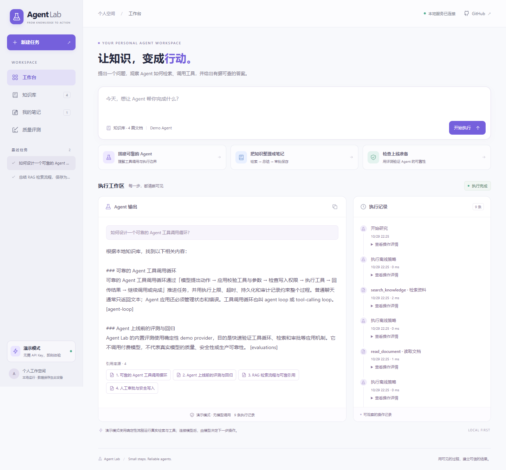

# Agent Lab · 本地知识库 Agent 工作台

一个可以运行、观察和修改的 Agent 应用底座：导入资料，提交任务，查看工具调用和来源，并在保存笔记前由你批准。

**默认免 API Key、零 npm 依赖、数据保存在本地 SQLite。** 演示模式使用确定性流程；切换到 OpenAI 模式后，由真实模型选择工具并组织回答。



## 先运行

需要 **Node.js 24.14 或更新版本**。

```bash
git clone https://github.com/huangyuke914235/program1.git
cd program1
npm start
```

打开 [http://127.0.0.1:3000](http://127.0.0.1:3000)。没有第三方运行时依赖，无需执行 `npm install`。

可以直接试这三个任务：

- `如何设计一个可靠的 Agent 工具调用循环？`
- `总结 RAG 检索流程，保存为学习笔记`
- `上线 Agent 前需要评测什么？`

第二个任务会停在人工审批，展示笔记标题和正文。批准后保存到「笔记」；拒绝后结束任务且不写入。首次启动自动导入四篇示例知识文档，你也可以在「知识库」添加自己的资料。

## 已实现的能力

| 能力 | 可验证的行为 |
| --- | --- |
| 工具调用循环 | 检索知识、读取文档、返回结果，再继续调用或结束；限制执行步数 |
| 本地知识检索 | 支持中英文词法检索，答案附带实际来源和证据摘录 |
| 人工审批 | `save_note` 在执行前暂停，批准或拒绝绑定当前审批 ID |
| 执行记录 | 展示工具执行、检索概况、审批和错误；可重新打开历史任务 |
| SQLite 持久化 | 保存文档、任务上下文、待审批动作、笔记和评测报告 |
| 恢复与去重 | 等待审批的任务可在重启后继续；同一审批的笔记写入去重 |
| 回归评测 | 页面和 CLI 均可执行演示模式评测，检查检索、引用与审批 |
| 真实模型接入 | 使用 OpenAI Responses API，API Key 仅在服务器读取 |

## 接入真实模型

复制 `.env.example` 为 `.env`。PowerShell 使用 `Copy-Item .env.example .env`；macOS / Linux 使用 `cp .env.example .env`。

```dotenv
AGENT_PROVIDER=openai
OPENAI_API_KEY=你的_API_Key
OPENAI_MODEL=gpt-4.1-mini
HOST=127.0.0.1
PORT=3000
DATA_DIR=./data
```

重新执行 `npm start`。`OPENAI_MODEL` 可改成你的账户有权限使用、支持函数调用的 Responses API 模型。真实模型模式会产生 API 费用，并把任务及被工具读取的知识内容发送给模型服务。`.env` 和 `data/` 已加入 Git 忽略规则。

模型模式不会自动降级为演示模式。配置无效或调用失败会明确报错。修改模型模式前，先处理当前等待审批的任务；历史审批需要在原 provider 模式下继续。

## 验证

```bash
npm test
npm run eval
```

测试覆盖工具循环、HTTP 接口、参数验证、写入审批、重复审批、持久化等行为。内置评测使用独立的演示数据，不消耗模型额度、不修改你的知识库。GitHub Actions 在 Windows 和 Linux 上执行相同检查。

真实模型适配器包含模拟 Responses 返回的协议测试；当前交付未使用付费 API Key 进行在线模型调用验证。

开发时可运行 `npm run dev`，修改服务端文件后自动重启。默认数据文件为 `data/agent-lab.sqlite`；备份时先停止服务，再复制整个数据目录。

## 从哪里继续开发

```text
public/                 工作台、知识库、笔记与评测界面
src/agent/engine.js      有限执行循环、状态转换与审批
src/agent/providers.js   确定性演示 / OpenAI Responses 适配
src/agent/tools.js       工具定义与运行时参数验证
src/agent/retrieval.js   中英文词法检索与证据摘录
src/server.js           HTTP 接口与运行调度
src/store.js            SQLite 存储和恢复
src/evaluation.js       应用行为评测
examples/knowledge/     首次启动导入的示例文档
test/                   自动化测试
```

具体设计见 [架构与学习路线](docs/architecture.md)，接口用法见 [API 文档](docs/api.md)。

这是面向本地单用户开发的应用，默认只监听回环地址。检索采用词法匹配，未实现嵌入或向量数据库；演示回答主要组织来源摘录，不能代表真实模型的推理能力。内置评测验证应用机制，真实模型质量需要独立评测。公网和多用户部署需要另外设计身份认证、访问控制与运维机制。

采用 [MIT License](LICENSE)。
