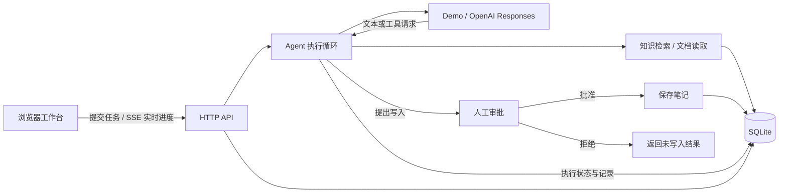
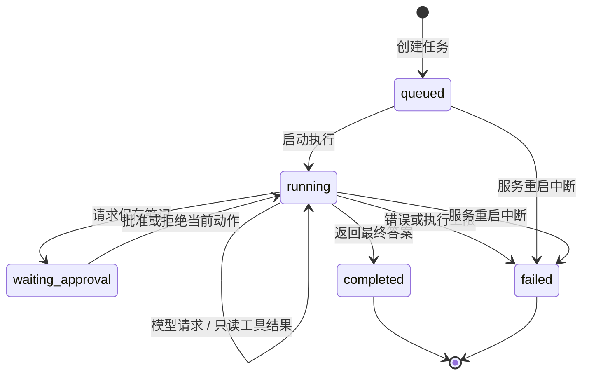

# 架构与学习路线

Agent Lab 把模型适配、工具执行、人工审批和界面展示分开。这样换模型时可以复用工具和存储；修改知识检索时，也可以独立运行回归评测。

## 数据如何流动

浏览器只访问本地 HTTP 接口。真实模型 API Key 由服务器从环境变量读取，不通过配置接口返回。知识内容和模型结果按文本展示，不当作 HTML 执行。

## 运行状态

等待审批的任务保留上下文，重启后可以继续。正在执行时意外重启的任务会标为失败，由用户重新提交，避免永久显示「运行中」或悄悄重放动作。

## 关键边界

### 模型只提出动作，应用决定能否执行

`src/agent/tools.js` 定义 `search_knowledge`、`read_document` 和 `save_note` 的参数结构。模型提出工具调用后，执行循环再次验证工具名和参数，不能只相信模型遵守 schema。

只读工具直接执行。`save_note` 先生成 `pendingApproval`，持久化准确的标题和正文，再暂停运行。审批请求需要同时提交决定和当前审批 ID；重复、过期或状态不匹配的审批被拒绝。

### 工具结果是证据

文档和检索结果可能包含诱导指令，所以按不可信数据处理。应用权限不能由文档内容决定。当前工具集合不能执行任意代码、读取任意磁盘文件或发送消息。

检索结果包含实际文档 ID、标题和摘录。答案引用与已读取或检索到的来源关联，界面展示相应证据。来源存在不代表每句话都被证明，仍需在真实模型评测中检查回答是否忠于证据。

检索使用重叠文本块和 BM25 排序，并保留原文偏移；长文档读取优先返回与问题相关的片段。这是词法检索，还不能识别所有同义表达。

服务端使用 Zod 校验输入，Pino 输出方法、路径、状态和耗时等结构化日志。浏览器用 SSE 接收状态更新，连接不可用时回退到轮询。Docker Compose 将应用和 SQLite 数据卷分开，方便复现与保存数据。

### 执行记录是可观察事件

`steps` 记录工具执行、检索概况、审批、时间和错误，展示的是可观察动作的摘要。完整工具参数与结果保留在内部运行上下文中，不通过公开运行接口返回。执行记录用于审计与调试，不展示或推断模型的隐藏思考过程。真实模型模式的 token 统计来自服务返回；演示模式没有模型推理成本。

### 状态与副作用需要持久化

`src/store.js` 使用 Node 内置 `node:sqlite`，把完整内部运行状态序列化保存。API 返回运行信息时移除内部 `state`，避免把模型上下文当成界面协议。

待审批调用与运行上下文一起保存。笔记写入使用运行 ID 和审批 ID 组成幂等键；同一动作重复保存时返回已存在笔记。运行调度另有内存锁，防止单进程内同时推进同一任务。

SQLite 中保存的是明文开发数据。默认目录 `data/` 不提交到 Git。生产场景的加密、留存周期、备份和用户隔离需要另行设计。

## 两种 provider

| 模式 | 行为 | 适用目的 |
| --- | --- | --- |
| `demo` | 确定性执行检索、阅读、组织摘录和可选保存；不调用外部模型 | 免 Key 试用、调试应用流程、快速回归 |
| `openai` | 通过 Responses API 交给模型选择工具，回传工具结果后继续 | 使用真实模型完成知识任务 |

两种模式复用同一个执行循环和审批规则。真实模式使用 `store: false`，由本地保存对话状态并回传必要的上下文；这不等同于对模型服务数据保留政策作出保证。

OpenAI 模式保留函数调用和结果之间的 `call_id` 关联，并保留继续调用所需的模型输出。每次调用设置超时；一次运行最多执行 12 步，模型请求与工具动作都占用同一个预算，暂停等待审批不重复计步。错误被显示为失败，不自动伪装成成功的演示回答。

官方接口说明：[OpenAI 函数调用](https://developers.openai.com/api/docs/guides/function-calling)。本地存储接口：[Node.js SQLite 文档](https://nodejs.org/api/sqlite.html)。

## 五步读懂项目

1. **先看一次完整运行。** 用首页问题观察检索、阅读和带来源的答案；再执行保存笔记并分别尝试批准与拒绝。
2. **读 `tools.js` 与 `retrieval.js`。** 把一个自然语言问题对应到工具名、参数、检索结果和来源，理解应用真正执行了什么。
3. **读 `engine.js`。** 沿着 `queued → running → waiting_approval → completed` 看状态如何变化，关注计数器、错误处理和持久化时机。
4. **比较两个 provider。** 找到「提出工具请求」与「执行工具」的边界，理解更换模型不应改变应用权限。
5. **运行测试和评测后再改功能。** 先新增一个只读工具，再为它补充成功、无结果和参数错误的行为检查。

## 后续扩展

- 资料规模增长时，将检索接口替换为全文索引、向量检索或混合检索，并保留相同的来源结构。
- 添加工具时，同时增加定义、运行时验证、执行分支、权限分类和失败用例。
- 添加真实模型评测时，为问题标注期望来源和结论，记录模型、提示词和数据集版本。
- 引入多用户之前，把用户身份、资源归属、审批者权限和隔离策略放进服务器接口与存储层。

当前没有通用工作流编辑器、任意代码执行、网络搜索、嵌入服务或多用户认证。词法检索可能漏掉同义表达，运行记录数量和数据规模也面向本地开发。扩展时应先确定具体任务，再替换对应边界。
